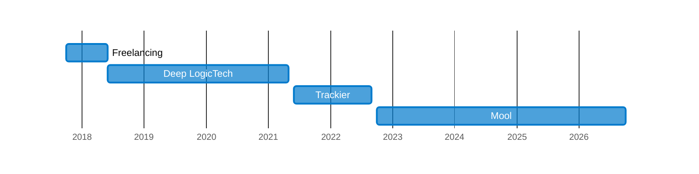

# Arpit Jain

**Founding Engineer &middot; Backend & AI Platforms &middot; Delhi, India**

I build backend and AI systems that hold up at scale, and lead the teams that run them. Over 8+ years at startups that has meant a 2B+ requests/day ad-tech tracking pipeline, a fintech app with 500K+ users, and an LLM research platform serving 1.2B+ tokens a day. Before that, I worked on security and networking R&D: a TCP/UDP layer that serves traffic with no inbound firewall ports open, a load balancer spanning multiple clouds, and a secure remote-access product.

## Journey

Happy to connect on [LinkedIn](https://linkedin.com/in/arpit9616).

## Tech Stack

**Languages & Runtimes**

  
  &nbsp;
  
  &nbsp;
  

 

**Databases & Messaging**

  
  &nbsp;
  
  &nbsp;
  
  &nbsp;
  
  &nbsp;
  
  &nbsp;
  
  &nbsp;
  
  &nbsp;
  

 

**Infrastructure & Cloud**

  
  &nbsp;
  
  &nbsp;
  
  &nbsp;
  
  &nbsp;
  
  &nbsp;
  
  &nbsp;
  
  &nbsp;
  

 

**AI & LLMs**

  
  &nbsp;
  
  &nbsp;
  
  &nbsp;
  
  &nbsp;
  
  &nbsp;
  
  &nbsp;
  
  &nbsp;
  

